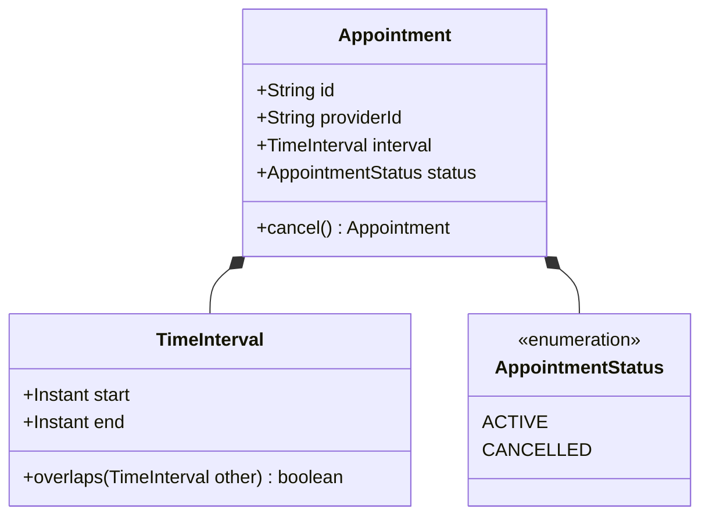

# Design Specification — Appointment Scheduler Service Slice

## 1. Executive Summary & Service Boundary
This service implements a bounded, high-reliability micro-service slice for **conflict-safe appointment booking and cancellation**. 
It guarantees that a healthcare or service provider cannot be double-booked across overlapping active time intervals while allowing cancelled slots to be immediately reused.

### Scope Inclusions & Exclusions
- **In Scope:**
  - Conflict-safe appointment booking.
  - Slot cancellation with history retention and state transition (`ACTIVE` $\rightarrow$ `CANCELLED`).
  - Strict interval overlap detection supporting zero-gap adjacency.
  - Idempotent and descriptive cancellation results.
  - Thread-safe concurrency control under high contention.
  - Parameter and temporal range input validation.
- **Out of Scope (Explicit Boundaries):**
  - Frontend / UI components.
  - Authentication, authorization, and multi-tenant security headers.
  - Patient management data models or demographics.
  - Notifications (SMS/email) and calendar integrations (iCal/Google Calendar).
  - External database engines (RDBMS/NoSQL) — in-memory persistence is preserved as per starter contract.

---

## 2. Domain & Data Architecture

The domain model is built on immutable Java records ensuring thread safety, referential transparency, and deterministic validation.

### Data Model Schema



- **`Appointment` (Record):**
  - `id`: Non-empty String (client-supplied unique identifier).
  - `providerId`: Non-empty String identifying the service provider.
  - `interval`: Immutable `TimeInterval` value object.
  - `status`: Enum (`ACTIVE`, `CANCELLED`).
  - `cancel()`: Factory method returning a cloned record in `CANCELLED` status.
- **`TimeInterval` (Value Object Record):**
  - `start`: UTC `Instant` (inclusive lower bound).
  - `end`: UTC `Instant` (exclusive upper bound).
  - Invariant: $start < end$ strictly enforced during record construction.
- **`AppointmentStatus`:**
  - `ACTIVE`: Participates in overlap evaluation.
  - `CANCELLED`: Retained for auditability; ignored during overlap checks.

---

## 3. The Booking Invariant & Overlap Mathematics

### Invariant Definition
> **For any single provider, no two `ACTIVE` appointments may overlap in their time intervals at any point in time.**

### Interval Semantics: Half-Open Intervals $[start, end)$
Appointments are modeled as half-open intervals $[s, e)$:
- $s$ is inclusive: The appointment begins at $s$.
- $e$ is exclusive: The appointment ends at $e$, making $e$ available for the next appointment.

### Overlap Condition
Two appointments $A = [s_A, e_A)$ and $B = [s_B, e_B)$ overlap if and only if:
$$\max(s_A, s_B) < \min(e_A, e_B)$$
Equivalently:
$$s_A < e_B \quad\land\quad s_B < e_A$$

### Adjacency Handling (Zero-Gap)
If appointment $A$ is $[10:00, 11:00)$ and appointment $B$ is $[11:00, 12:00)$:
$$\max(10:00, 11:00) = 11:00, \quad \min(11:00, 12:00) = 11:00$$
$$11:00 < 11:00 \implies \mathbf{false} \quad (\text{No Overlap})$$
Adjacent appointments are mathematically permitted without complex conditional logic.

---

## 4. Concurrency & Persistence Architecture

### Concurrency Challenge: TOCTOU
Without synchronisation, two simultaneous requests for the same slot can read the store simultaneously, observe no conflict, and both insert active bookings, violating the booking invariant.

### Locking Strategy: Partitioned ReentrantReadWriteLock
- Storage is backed by `ConcurrentHashMap<String, List<Appointment>>` partitioned by `providerId`.
- Fine-grained read/write synchronization is managed by `ConcurrentHashMap<String, ReentrantReadWriteLock>`:
  ```java
  private final Map<String, ReentrantReadWriteLock> providerLocks = new ConcurrentHashMap<>();
  private ReentrantReadWriteLock getLock(String providerId) {
      return providerLocks.computeIfAbsent(providerId, k -> new ReentrantReadWriteLock());
  }
  ```
- **Read/Write Segregation (High Throughput Architecture):**
  - **Shared Read Locks (`readLock()`):** Multiple concurrent readers querying `GET /api/appointments/{providerId}` acquire shared locks simultaneously. Even under heavy polling loads (e.g. 500+ requests/sec), readers do **not** block or serialize against each other.
  - **Exclusive Write Locks (`writeLock()`):** Booking (`bookAppointment`) and cancellation (`cancelAppointment`) acquire the exclusive write lock, ensuring that the check-then-insert critical section is atomic and protected against TOCTOU race conditions.
  - **Trade-off Analysis:**
    - *Mutual Exclusion (`ReentrantLock`):* Simple, but severely throttles read throughput because reads lock out both writes and other reads.
    - *Read/Write Segregation (`ReentrantReadWriteLock`, Selected):* Unlocks high-concurrency read throughput while maintaining 100% strict mutual exclusion for writes.
    - *Global Lock:* Serializes bookings across all unrelated doctors/providers.
    - *Per-Provider Partitioning (Selected):* Isolates lock contention strictly to requests targeting the same provider. Requests for different providers execute in parallel with zero lock interference.

---

## 5. API Design & HTTP Status Contract

| HTTP Method | Route | Request Payload | Success Status | Error Responses |
|---|---|---|---|---|
| `POST` | `/api/appointments` | `BookingRequest` (id, providerId, start, end) | `201 Created` | `409 Conflict` (overlap), `400 Bad Request` (validation) |
| `PATCH` | `/api/appointments/{providerId}/{id}/cancel` | None | `200 OK` (CANCELLED record) | `404 Not Found` (missing ID), `200 OK` (already cancelled notice) |
| `GET` | `/api/appointments/{providerId}` | None | `200 OK` (List of records) | — |

### Structured Error Response
All errors yield a consistent JSON body produced by `GlobalExceptionHandler`:
```json
{
  "timestamp": "2026-10-31T06:11:27.813Z",
  "status": 409,
  "error": "Conflict",
  "message": "Booking rejected: Overlaps with an existing active appointment for provider Dr-Live",
  "path": "/api/appointments"
}
```
